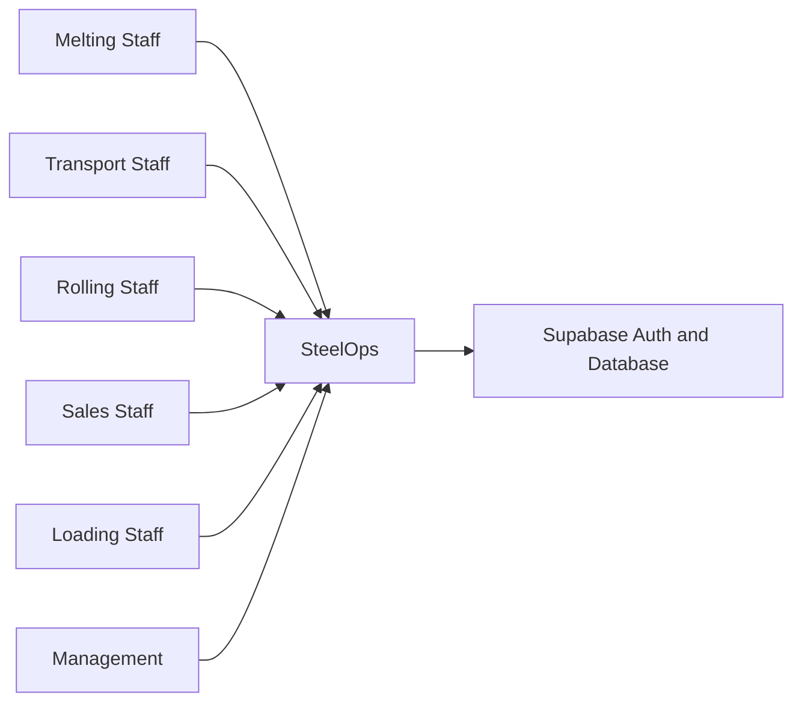
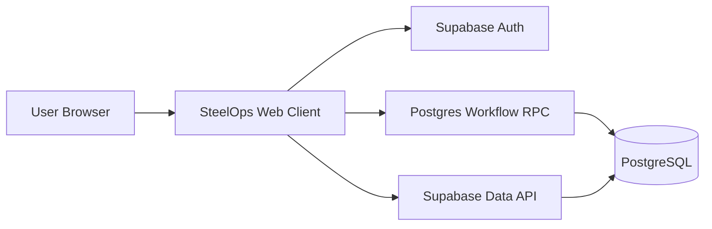
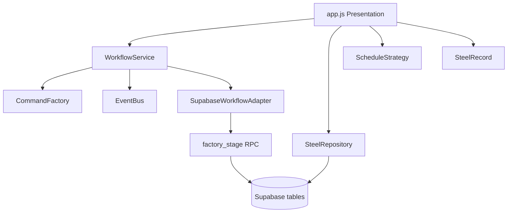

# C4-inspired architecture diagrams (Mermaid source)

## Level 1 — Context

## Level 2 — Container

## Level 3 — Component

These are source diagrams, not independently generated images. Render inside Mermaid-compatible Markdown viewer and inspect manually before submission.
