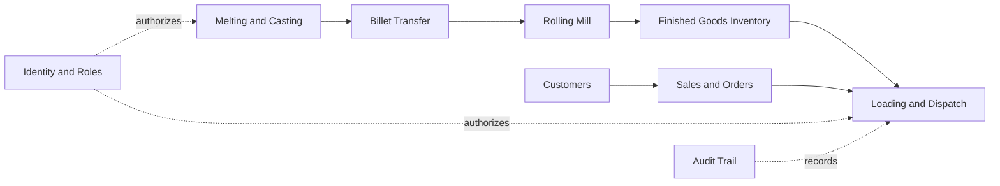

# Domain and bounded context map

## Core domain: production
- Melting & Casting: **Heat** owns furnace, heat number, weight, four stage timestamps, ready-to-transfer state.
- Billet Transfer: **Transfer** depends on a completed casting event; one transfer per heat in V0.8.
- Rolling: **RollingBatch** depends on arrived billet, chosen diameter, start and finish; only completed batches contribute to inventory.

## Supporting domain: commerce and fulfillment
- Customers: Customer belongs to sales context.
- Sales: SalesOrder holds customer, diameter, quantity, price, terms, order state.
- Loading: LoadingEvent references SalesOrder and consumes available size-specific stock on confirmation.

## Generic domain: administration
- Profiles, Authentication, ChangeRequests and AuditLog. The UI role is never sufficient authorization: every privileged transition needs authenticated server-side authorization.

## Context map

### Known domain limitations
One heat is modeled as one transfer and one rolling batch; production split and multiple bar sizes per heat are explicitly out of scope until reworked. Combined melting+casting planning marker is 210 minutes, *not* the standalone melting duration. Cooling and casting individual expected durations remain unknown; do not invent them.
