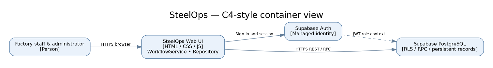

# Project report: Software Design and Architecture

> **SteelOps — Integrated Steel Production and Operations Management System**  
> **Submission status:** evidence-based draft. Preserve the headings and questions below. The instructor's exact report template, supplied in chat, is the authoritative structure. Complete the clearly marked team details and obtain screenshots before submission.

## Overall project checklist

- [x] Repository scaffolded and a SOLID-oriented extraction documented (M1–M2); inspect `architecture.js` and `docs/REFACTORING.md`
- [x] Creational/structural and behavioral patterns present in implementation (M3–M4)
- [x] Architectural style documented (M5)
- [x] Domain model and decomposition rationale documented (M6–M7)
- [x] Resilience timeout / bounded retry on external read-only calls (M8), covered by deterministic tests; live failure testing remains pending.
- [x] Architecture Decision Records written (M9)
- [x] Quality evaluation of incorrect 120-row overview counts led to exact-count API refactor; performance SLA against live large dataset remains pending.
- [ ] Report completed and submitted (Sprint B): **team details/screenshots/evidence pending**

## Group information

### Question 1: Group members

List the group number and the student/member ID for each team member.

**Group number:** [TO BE PROVIDED]

- Abdalla Abbas — 230504645
- Ahmed Elsayed — 230504538

*Confirm spelling, actual membership, and group number before submission.*

### Question 2: Third-party frameworks

Did you use any open-source frameworks or libraries not covered in the course? Which ones, and how did they help?

SteelOps uses the Supabase JavaScript client to communicate with Supabase Auth and PostgreSQL REST/RPC services. Supabase provides managed authentication, row-level security, and database functions. The browser frontend uses JavaScript, HTML, and CSS, while automated architectural tests use Node.js built-in test capabilities. The system does not claim to use a separate frontend framework such as React. The Supabase client simplifies integration but creates a dependency on an external backend; `SupabaseWorkflowAdapter` limits the scope of that dependency.

## Structure and design principles (Modules 1-2)

### Question 3: Package structure

How is your codebase organized into packages/modules? What was the reasoning behind that structure?

The current prototype is arranged as browser JavaScript modules rather than a package-managed server application. `index.html` and `style.css` define presentation; `app.js` handles page orchestration, access-controlled navigation, and user interactions; `models.js` holds model-specific formatting and validation utilities; `architecture.js` contains reusable domain/application components; and `repository.js` groups persistence operations against Supabase. The SQL files define server-side workflow operations and access controls. The `tests/` directory contains automated architectural and role-matrix tests; `docs/` captures ADRs, bounded contexts, diagrams, and evaluation criteria. The design isolates high-value business rules from UI concerns so they can be tested without a browser. This refactor is deliberately incremental: `app.js` still contains substantial presentation and coordination logic, and complete separation of every feature remains future work.

### Question 4: SOLID in practice

Describe one place where you deliberately applied a SOLID principle (or refactored toward one). Include a short before/after comparison.

**Principle: Single Responsibility, supported by Dependency Inversion.** Originally, workflow button handlers in `app.js` combined argument validation, direct Supabase RPC calls, UI feedback, and event coordination. That meant testing stage validation required exercising browser-oriented code and using a backend or a simulated database response. In the later implementation, `architecture.js` separates these concerns. `CommandFactory.create(action,id,args)` validates the command and normalizes its payload. `WorkflowService.run()` accepts a port exposing `execute(command)` and only publishes a `workflow.saved` event after success. `SupabaseWorkflowAdapter.execute()` converts that command to a Supabase `factory_stage` RPC call. As a result, domain command validation and service behavior can be tested with a fake port in Node, independently of Supabase and the DOM. **Trade-off:** the extracted layer adds interfaces and indirection, but makes the workflow more maintainable. This is an incremental refactor, not proof that the entire codebase satisfies every SOLID principle. Evidence: `architecture.js`, `docs/REFACTORING.md`, `tests/domain.test.js`.

## Design patterns (Modules 3-4)

### Question 5: Creational or structural patterns

Which creational or structural patterns did you use, and what problem did each one solve in your system? If you considered one and decided against it, say why.

**Factory Method-style command creation:** `CommandFactory.create` creates validated workflow command objects from user-supplied action, ID, and payload. For `rolling_start`, for example, it restricts product size to 12, 14, or 16 mm; for dispatch it validates quantity and vehicle plate. The factory centralizes validation instead of duplicating it across separate pages. This is a lightweight factory for command objects rather than a complete abstract-factory hierarchy.

**Adapter (structural):** `SupabaseWorkflowAdapter` converts application commands to the specific `client.rpc('factory_stage', ...)` calling convention and normalizes errors into exceptions. That allows `WorkflowService` to depend on the small `execute()` contract rather than on the Supabase SDK. `repository.js` similarly keeps persistence queries outside some UI handlers (Repository-style data access). We did not adopt additional factories or service locators simply to increase the pattern count; the prototype benefits more from small explicit dependencies.

### Question 6: Behavioral patterns

Which behavioral patterns did you use, and what problem did each one solve?

**State:** `HeatStateMachine` expresses permissible production transitions, from melting and casting through transport and rolling. A client can ask whether a transition is valid before attempting it. This component is currently a guidance/testable model; the SQL `factory_stage` function is the authoritative stage validator for server mutations.

**Observer:** `EventBus` allows listeners to subscribe to domain events without coupling them to RPC transport. `WorkflowService` publishes `workflow.saved` only after a successful server response, preventing the UI from announcing uncommitted operations.

**Strategy:** `ScheduleStrategy` encapsulates duration forecasts and early/on-time/delayed evaluation using configurable minute values. The current UI has not fully migrated all schedule rendering to the strategy, which is an acknowledged limitation. These patterns were selected for real variability, not to introduce unnecessary inheritance.

## Architectural style (Module 5)

### Question 7: Architectural style

Which architectural style did you choose (layered, event-driven, microservices, or another)? What quality attributes drove that choice, and what did you give up to get them?

SteelOps uses a **layered, modular browser application with a managed Supabase backend**—a small modular-monolith-style deployment, not independent microservices. The presentation layer is `index.html`/`app.js`, domain/application logic is partly extracted to `architecture.js` and `models.js`, the persistence adapter is `repository.js` and `SupabaseWorkflowAdapter`, and the backend uses Supabase Auth plus PostgreSQL with row-level security and transactional RPCs. The key quality attributes are correctness of production transitions, maintainability, restricted staff access, and low operating complexity for a student team. Shared PostgreSQL transactions are particularly useful for making a rolling/dispatch workflow consistent.

A distributed microservices design would allow independently scaled deployments but would add service discovery, cross-service consistency, networking failure modes, and operational overhead. For this prototype that complexity outweighs potential benefits. The trade-off is less independent scaling of modules and stronger dependence on Supabase. The design still identifies logical boundaries for later extraction if growth justifies it. Relevant records: `docs/ADR-001.md`, `docs/ARCHITECTURE.md`, and `docs/C4.md`.

## Domain-driven design (Module 6)

### Question 8: Domain model

Describe your domain model. Did you identify more than one bounded context? If yes, what is the boundary between them?

The domain connects a **Heat** (furnace, heat number, casting stages and weight) to a **Transfer** (billet movement and arrival), a **Rolling Batch** (size, start/end, produced tons), **Finished Goods Inventory** (quantity available by size), **Customer and Sales Order** (requested quantity, size, and payment terms), and **Loading Event/Dispatch** (truck and shipped tons). Governance entities include staff roles, correction requests, and audit entries. The main invariants are that a heat must finish casting before transfer, rolling requires arrived billets, produced tons cannot exceed delivered billets for a completed rolling batch, and dispatched tons must not exceed available inventory or order balance.

Logical bounded contexts include **Production** (melting/casting), **Billet Logistics** (transfers), **Rolling**, **Commercial** (customers/orders), **Fulfillment** (dispatch/inventory), and **Governance** (identity/audit). Boundaries are represented by modules and transactional operations, not separately deployed services. Example: Fulfillment refers to the Commercial sales-order identity and uses the Rolling production history to compute stock. The prototype currently assumes one transfer and one rolling batch per heat; split processing is out of scope.

## Microservices (Module 7)

### Question 9: Service decomposition

Is your system one service or several? If several, how did you decide the boundaries? If one, explain why splitting it further would not have helped.

The application is one web deployment backed by Supabase Auth and PostgreSQL. It is logically decomposed into Production, Billet Logistics, Rolling, Commercial, Fulfillment, and Governance modules, but they are not independent network services. This decision reflects expected student-project scale and the high coupling of production transitions: casting completion enables transfer, transfer arrival enables rolling, and finished rolling production affects dispatch stock. Splitting the stages into independent microservices would introduce asynchronous integration, eventual consistency, additional deployment pipelines, and failure recovery for events that can currently be validated within PostgreSQL transactions. A single managed backend also simplifies RLS and identities for the seven roles. The downside is less independent deployment/scaling and some growing `app.js` complexity. If traffic or team size increases, the bounded contexts offer candidate extraction points after contracts are stabilized.

### Question 10: API design

How do your services (or your service and its clients) communicate? Describe the API contract for at least one endpoint.

The browser communicates with the external Supabase API over HTTPS, using an authenticated user session. One workflow contract is the PostgreSQL RPC **`factory_stage(p_action text, p_id bigint, p_args jsonb)`**, invoked through the Supabase JS client's `rpc` method. Example: `p_action='rolling_start'`, `p_id=<heat id>`, `p_args={"size_mm":12}`. The server checks the active user's role, verifies that the associated billets have arrived, prevents duplicate rolling records, and returns JSON containing the created record ID, stage, and timestamp. Invalid transitions or unauthorized roles result in an error and no completed transaction. The browser never supplies a trusted staff role; authorization is read from server-side `profiles`. Refer to `architecture.js` and the deployed migration function. **Note:** this is a description of the designed RPC contract, not a claim that every security test has passed.

## Distributed systems and resilience (Module 8)

### Question 11: Resilience patterns

Where did you apply a retry, timeout, or circuit breaker? What failure was it protecting against?

**Implemented resilience pattern:** In `architecture.js`, `resilientRead()` applies an 8-second client waiting timeout and a bounded two-retry policy with exponential backoff for transient read failures. `repository.js` uses this for fetch/profile/count calls; `SupabaseWorkflowAdapter.inventory()` applies it to inventory RPC. The real failure being addressed is a temporary interrupted/slow Supabase network connection. In `tests/resilience.test.js`, a fake API fails twice with network errors and succeeds on its third attempt; separate tests verify timeout and that 403 is not retried. Non-idempotent writes are **never automatically retried**. A local timeout does not cancel the server request: if a write response is uncertain, reload and reconcile before proceeding. These tests confirm the client policy, not a real-world service outage.

### Question 12: Consistency trade-offs

Did any part of your system have to choose between consistency and availability? How did you resolve it?

Yes, finished-goods dispatch prioritizes **consistency over accepting every request**. Inventory is derived from completed rolling production minus recorded shipments. The proposed server-side `factory_stage('dispatch',...)` transaction validates stock and remaining order quantity under a transaction-level advisory lock before inserting a loading event. When concurrent requests conflict or network status is uncertain, the UI should reject or defer an operation rather than assume it succeeded. As a result, a dispatch may not be accepted when the backend is unavailable, but this avoids misleading local stock figures. The concurrency safety claim still requires a live two-client test. This is a consistency/availability design trade-off in an external-call workflow, not a claim that Supabase has been configured as a multi-region distributed system.

## Architecture documentation (Module 9)

### Question 13: Architecture Decision Records

Include at least one Architecture Decision Record (context, decision, consequences) for a real trade-off your group made.

**ADR-001 — Managed backend and single application deployment**

**Context:** The team needs role-based access, production stage integrity, persistence, and understandable architecture within a limited project scope. A full microservices platform would add separate service hosting and asynchronous consistency management.

**Decision:** Use a browser application backed by Supabase Auth and PostgreSQL; keep logical domain modules while deploying one frontend and relying on transactional database RPCs for sensitive writes.

**Consequences:** Easier deployment, shared data transactions, centralized identity and a small operational footprint; in exchange, the application is tied to Supabase and services are not independently deployable. Security-definer RPCs and RLS need careful review. Full ADR and related decisions are in `docs/ADR-001.md` through `ADR-003.md`.

### Question 14: Architecture diagram

Include a C4-style (or equivalent) diagram of your overall system architecture and explain the steps in it.

*Required before submission:* add the actual rendered diagram at `reports/figures/steelops-c4.png`. The Mermaid source currently exists in `docs/C4.md`; the image is not yet included in this report bundle.

**C4 explanation:** Operators (melting, transport, rolling, sales, loading), management, and the administrator access a browser-based frontend. The frontend presents role-specific screens and passes validated commands through `WorkflowService` and `SupabaseWorkflowAdapter` to Supabase over HTTPS. Supabase Auth establishes identity; PostgreSQL policies and workflow functions enforce authorized mutations and store production, sales, and dispatch records. The backend returns persisted results, after which the frontend updates the view and emits success notifications. `repository.js` supplies other read/write access patterns to UI modules, while `architecture.js` isolates tested domain behavior. This is a logical C4-style container/component description, not a representation of physically independent microservices. A one-sentence overview is insufficient to explain every trust boundary, so the diagram should show the external Supabase boundary and the distinction between browser validation and server authorization.

## Quality evaluation and refactoring (Module 10)

### Question 15: Quality attribute scenario

State one quality attribute scenario you evaluated your design against (for example: "the system should handle a 10x traffic spike without manual intervention"). What did the evaluation find?

**Scenario: authorization of role-limited workflows.** Source: a user logged in as Melting Supervisor. Stimulus: attempts to invoke dispatch or access an unrelated operational screen. Environment: browser with valid Supabase session. Expected response: the unrelated screen is unavailable and backend denies the forbidden action without changing any loading row. Measurement target: 100% of forbidden role/action pairs denied. An initial UX review found that staff menus displayed irrelevant sections and that edit requests were sometimes restricted to records created by the current staff user. These observations drove a role-visibility refactor and changes to edit-request presentation. The team subsequently reported that visible pages operated without errors. **Limitations:** browser menu tests and manual reports do not establish that all Supabase RLS or direct RPC permission checks pass. A documented cross-role integration test and evidence are still required for a complete evaluation.

### Question 16: Refactor driven by the evaluation

Describe a refactor you made as a direct result of that evaluation.

The role-visibility review led to a targeted presentation refactor: instead of exposing most operational sections to all authenticated personnel, the navigation now builds the available pages from role rules. Thus a rolling operator sees Rolling Mill, and a loading operator sees Loading & Dispatch, rather than unrelated melting and sales pages. A direct-navigation guard and role-matrix unit tests were also added. This improved clarity and reduced accidental cross-team actions. Crucially, hidden navigation alone is not access control: the backend must separately enforce staff roles for all queries and mutations. This refactor is evidenced by the updated `app.js` and `tests/role_access.test.js`; role-based backend authorization remains an explicit integration-test gate.

## Overall discussion

### Question 17: Struggles

What were the biggest struggles in the project, and how did you address them?

The most challenging design choice was deciding how much of the steel-production process to model. A real factory includes multiple furnaces, continuous casting, billet transfer, rolling, changing sizes, sales orders, and truck dispatch. Modeling all possible physical scenarios would have exceeded the educational objective. The team deliberately scoped the prototype to sequential stage records linked by heat and sales-order identifiers, recognizing that one heat cannot yet be split into multiple transfer or rolling batches. Another challenge was maintaining correct quantity calculations across inventory and dispatch. The design computes available inventory from completed production and recorded shipments and validates dispatch within a database transaction rather than trusting a number displayed in the browser. Authorization also needed attention: early role-based menus were too broad and edit requests depended on record ownership rather than departmental responsibilities. The UI was reworked to better match real staff workflows. Finally, architectural documentation was initially separate from implementation; the project introduced a dependency-free `architecture.js` layer and automated tests to make patterns visible in code. Remaining concerns include the unverified RLS behavior, the non-idempotent nature of writes under ambiguous network failure, and the need for live network/RLS verification.

### Question 18: Contributions and AI tool usage

State each team member's individual contributions. Additionally, state if/how you used generative AI tools (ChatGPT, Copilot, etc.) in the project.

**Individual contributions — must be completed truthfully by the group:**

- Abdalla Abbas (230504645): [DESCRIBE ACTUAL WORK, E.G. DESIGN, IMPLEMENTATION, TESTING, DOCUMENTATION]
- Ahmed Elsayed (230504538): [DESCRIBE ACTUAL WORK]

**Generative AI disclosure:** ChatGPT was used to assist with brainstorming architecture, drafting/refining JavaScript and SQL, reviewing role-based workflows, generating test and documentation drafts, and explaining implementation steps. AI-generated material requires human review, testing, and understanding; the group is responsible for confirming correctness and being able to explain its design decisions. Update this statement to reflect actual group usage of other tools, if any. Do not claim an AI-assisted function was manually implemented or tested if that is not true.

### Question 19: Extras

Did you implement anything not covered by the questions above? What, and why?

SteelOps includes a role-aware production timeline for two furnaces sharing a casting process, expected versus actual stage timing, a correction-request/administrator approval workflow, audit-oriented records, and inventory derived by reinforcing bar diameter. These capabilities help demonstrate that architectural choices matter across distinct responsibilities, but are not claimed to make the prototype production-ready. Additional limitations include absent split-batch support, incomplete integration tests, and the need for stronger database security verification.

---

## Submission readiness notes (remove from final submitted report after completion)

1. Replace the group number and verified individual contributions in Questions 1 and 18.
2. Add `reports/figures/steelops-c4.png` and any requested UI screenshots.
3. Implement a real and tested timeout/retry/circuit-breaker for Question 11; revise the answer to describe evidence.
4. Perform the backend role/RLS and inventory concurrency evaluation and record measurements for Question 15.
5. Ensure the published report preserves **all instructor headings and questions**; this file is aligned to the user's supplied template but should be compared with the actual repository's template file before submission.
